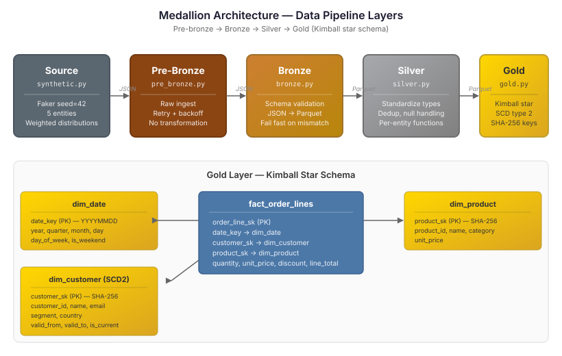
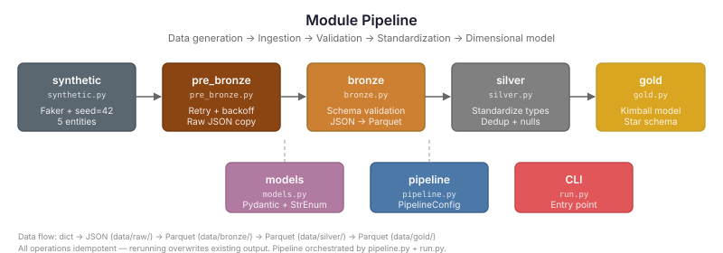

# Medallion Architecture Template

[](https://github.com/tbsvendsen/medallion-template/actions)
[](https://www.python.org/)
[](LICENSE)

A reference implementation of [medallion architecture](https://www.databricks.com/glossary/medallion-architecture)
for data pipelines. Processes synthetic order data through four layers into
a Kimball star schema — no cloud, no database, no API keys.

## Architecture



| Layer | Module | Input | Output | Purpose |
|-------|--------|-------|--------|---------|
| Pre-bronze | `pre_bronze.py` | API (simulated) | Raw JSON | Ingest with retry, exponential backoff, jitter |
| Bronze | `bronze.py` | Raw JSON | Parquet | Schema validation, fail fast on mismatch |
| Silver | `silver.py` | Bronze Parquet | Parquet | Standardize types, dedup, null handling |
| Gold | `gold.py` | Silver Parquet | Parquet | Kimball star schema with SCD type 2 |

### Gold Layer — Star Schema

| Table | Type | Key | Notes |
|-------|------|-----|-------|
| `dim_date` | Dimension | `date_key` (YYYYMMDD) | Generated calendar dimension |
| `dim_customer` | Dimension (SCD2) | `customer_sk` (SHA-256) | Tracks `valid_from/to`, `is_current` |
| `dim_product` | Dimension | `product_sk` (SHA-256) | Deterministic surrogate keys |
| `fact_order_lines` | Fact | FK to all dimensions | Grain: one row per order line |

## Module Pipeline



```
src/medallion/
├── synthetic.py    # Data generation (Faker, seed=42, 5 entities)
├── pre_bronze.py   # Ingestion with retry + exponential backoff
├── bronze.py       # Schema validation, JSON → Parquet
├── silver.py       # Per-entity standardizers (dedup, types, nulls)
├── gold.py         # Kimball star schema, SCD2, SHA-256 keys
├── models.py       # Pydantic v2 models, StrEnum
├── pipeline.py     # PipelineConfig (frozen dataclass)
└── run.py          # CLI entry point
```

## Quick Start

```bash
git clone https://github.com/tbsvendsen/medallion-template.git
cd medallion-template
python -m venv .venv && source .venv/bin/activate
pip install -e ".[dev]"
```

Run the pipeline:

```bash
python -m medallion.run
```

Output lands in `data/` with subdirectories per layer (raw, bronze, silver, gold).

Run tests:

```bash
pytest --cov
```

28 tests, 97% coverage.

## Design Decisions

1. **Polars over pandas** — Lazy evaluation, no index confusion, better type safety
2. **Parquet between layers** — Columnar, typed, compressed. No type ambiguity
3. **File storage, no database** — Simpler to inspect, version, and query with DuckDB
4. **Deterministic surrogate keys** — SHA-256 hash of natural key, stable across runs
5. **Schema validation at bronze** — Catch structural problems before any transformation
6. **One standardizer per entity** — Explicit, readable, testable. No generic "clean all"

See [ARCHITECTURE.md](ARCHITECTURE.md) for detailed documentation.

## Tech Stack

| Component | Library |
|-----------|---------|
| Data processing | Polars |
| Data models | Pydantic v2, StrEnum |
| Data generation | Faker (seed=42) |
| Testing | pytest, mypy (strict), ruff |

## License

MIT
